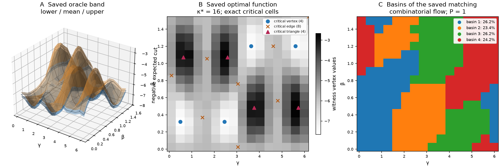

# CERTMORSE

**Certified critical-point counts for QAOA landscapes measured with finite shots.**

A variational quantum algorithm never sees its own landscape. It sees shot
averages, each carrying an error bar, and every dip in the measured surface
might be a genuine minimum or merely noise. CERTMORSE asks what can actually be
*proved* about the topology of a QAOA landscape from those error bars alone –
how many critical points the true landscape must have, which of its minima are
certainly not global, and how deep a minimum has to be before a given number
of shots can see it at all.

**Status:** Stage 1, which builds the certificates and measures their limits on
three MaxCut instances, is complete at `v0.1`. Stage 2, which asks whether any
of this predicts how often an optimiser succeeds, is planned and has not
started.

## The problem

Take a graph $G = (V, E, w)$ with $n \le 10$ vertices, integer edge weights and
total weight $W$, and its MaxCut cost $C = \sum_{ij \in E} w_{ij}(1 - Z_i Z_j)/2$.
Depth-one QAOA prepares

$$|\psi(\gamma, \beta)\rangle = e^{-i\beta \sum_j X_j}\, e^{-i\gamma C}\, |+\rangle^{\otimes n},$$

and an optimiser searches for the minimum of the landscape
$F(\gamma, \beta) = -\langle \psi(\gamma, \beta) | C | \psi(\gamma, \beta) \rangle \in [-W, 0]$.
With integer weights $F$ is periodic in both parameters, so it is a smooth
function on a torus $T^2$, and its topology is constrained accordingly: when
$F$ is a Morse function, its numbers of minima, saddles and maxima satisfy
$c_0 - c_1 + c_2 = \chi(T^2) = 0$. The minima that are not global are the
traps in which a local optimiser can end, and the areas of their basins of
attraction decide how often a randomly started optimiser succeeds.

The difficulty is that $F$ is never observed. At a parameter point the
hardware returns $N$ bitstrings, and their average estimates $F$ with a
standard error of order $\sigma/\sqrt{N}$. Sampling an $m \times m$ grid
therefore gives not a function but a *band*: at each grid point $v$ an interval
$[\ell_v, u_v]$, built so that all $m^2$ intervals contain the true values at
once with probability at least $1 - \alpha$ (exactly so for Hoeffding bands,
approximately for Gaussian ones). Infinitely many landscapes fit
inside such a band, and most of them are full of wiggles that the true
landscape does not have. The question CERTMORSE asks is therefore a
lower-bound question: which topological features must be present in *every*
landscape consistent with the band, and hence, whenever the band covers the
truth, in the true landscape itself? Concretely, how many critical points must
$F$ have, which of its minima are certainly not global, and how large must $N$
be before a minimum of a given depth is forced to appear?

## The approach

In the smooth setting this question is unwieldy, since the space of smooth
functions inside a band is infinite-dimensional and the critical points of a
generic one tell us very little. I therefore move to the discrete setting, where
discrete Morse Theory makes the count of critical points a finite, exactly
optimisable quantity.

Triangulate the grid into a simplicial torus $K$ with $m^2$ vertices, $3m^2$
edges and $2m^2$ triangles. In Forman's discrete Morse Theory, a function $f$
on the cells of $K$ is a discrete Morse function if each cell has at most one
face with a value at least its own and at most one coface with a value at most
its own. These exceptional pairs form an acyclic matching, the discrete
gradient, and the unmatched cells are the critical ones. The total number of
critical cells is $\kappa(f) = 6m^2 - 2|M|$ for a matching $M$, and the torus
again forces $c_0 - c_1 + c_2 = 0$, so $\kappa = 2(c_0 + c_2) \ge 4$. The band
extends from vertices to cells in the lower-star convention, with a cell
$\sigma$ allowed values in $[\max_{v \in \sigma} \ell_v,\ \max_{v \in \sigma} u_v]$,
so that the discrete gradient of the true field is itself one of the candidates.
The central object is then the simplest consistent landscape,

$$\kappa^{\ast} = \min \lbrace \kappa(f) : f \text{ discrete Morse on } K,\ f(\sigma) \in [\ell(\sigma), u(\sigma)] \text{ for every cell } \sigma \rbrace.$$

Its value is forced by the data: if the band covers the truth, and the true
gradient can be realised in the integer model (a mild separation condition, or
a direct exact check), then $\kappa^{\ast} \le \kappa_{\mathrm{true}}$. I compute
$\kappa^{\ast}$ as an integer program, with a binary variable for each candidate
pair in the matching and an integer value for each cell. Matched pairs may not
increase, unmatched incidences must strictly increase, and acyclicity then
follows automatically, since values would have to decrease strictly around
any closed gradient path. Two lower bounds certify the answer even when the
solver stops early: the solver's own dual bound and a combinatorial *region
bound*, which finds disjoint sublevel components of the band, each of which
must contain a critical vertex (and dually for maxima). Together they give the
chain

$$\kappa_{\mathrm{cert}} \le \kappa^{\ast} \le \kappa_{\mathrm{true}}.$$

The count alone does not say *which* minima are real, and for that I use
persistence, the height a minimum must climb before it merges with a deeper
one. Writing $w$ for the band's largest full width, every minimum of the true
field with persistence greater than $2w$ is guaranteed its own region in every
consistent landscape. If its depth above the global minimum also exceeds
$2w + \tau$, with tolerance $\tau = 0.02W$, the band alone certifies it as a
*trap*, a non-global minimum, and so proves that discrete gradient flow from a
uniformly random start cannot always succeed. I call $2w$ the band's
resolution. Finally, the discrete gradient of the simplest consistent landscape
partitions the grid into basins, and the area of those whose minimum lies
within $\tau$ of the lowest gives a predicted success probability $P$. This is
compared with the true success probability $P_0$ and with $P_0^{\mathrm{res}}$,
the true value after merging every minimum too shallow for the band to resolve.
Stage 1 measures how well these objects behave; Stage 2 asks whether $P$ says
anything about real optimisers.



*R8a, ideal channel, 16×16 grid, 1000 shots per point, band seed 0. (A) Lower
and upper band surfaces around the shot mean. (B) An optimal discrete Morse
function inside the band, with 4 critical vertices, 8 critical edges and 4
critical triangles, so κ\* = 16, equal to the true count. (C) The four basins of
its discrete gradient flow. Every panel is drawn from saved Stage 1 artefacts,
without solving or sampling again ([provenance](docs/images/stage1-r8a-oracle.json)).*

## What Stage 1 found

**Shots impose a hard resolution limit, and it can be computed.** If the band
covers the true field, every minimum with persistence above the resolution
$2w$ must appear in every consistent landscape, while anything shallower may
vanish from all of them. Hoeffding bands, which carry a distribution-free
guarantee, pay heavily for it: at 1000 shots their resolution is between 2.7
and 2.9 times that of oracle Gaussian bands on all three instances, and on R8a
their full width is about 22 standard errors at the noisiest grid point.
Because oracle widths shrink as 1/√N, the measured resolutions also say
roughly how many shots each feature needs. Extrapolating from them, W8a's ten
non-global minima on the adequate 32×32 grid (persistence 0.33 to 1.38) clear
the threshold at roughly 3×10³ to 5×10⁴ shots per point (scaling the
measured 16×16 oracle resolution by 1/√N and by the larger Bonferroni constant
of the 32×32 grid). E8a's deeper dimple
(persistence 0.016) needs about 4×10⁶, and its shallower one (0.004) sits
below the 4×10⁻³ floor that the bands' minimum width places on the resolution,
so no shot count guarantees it. With Hoeffding bands, even 10⁶ shots leaves
E8a's resolution at 0.086.

**Traps can be certified from shot data alone.** On W8a, oracle bands certify
2 to 4 non-global minima in every one of the twenty bands. Each certified trap
proves that discrete gradient flow on the true grid field, started from a
uniformly random grid point, cannot always reach the global minimum. The
certificate is conditional on the band covering the true field. However,
oracle coverage is only approximate (94.8% measured), so these particular
traps carry that caveat, whereas Hoeffding bands would carry a guarantee.

**E8a hides a plateau that shots cannot resolve.** At β = 0 the mixer does
nothing, the state stays a uniform superposition, and the expected cut is
exactly half the total weight, so the landscape is identically −W/2 = −5 along
that line. E8a's two non-global minima are shallow dimples, with persistence
0.004 and 0.016, sitting in the grid rows closest to β ≡ 0 and within 0.01 of
that random-cut value. Yet discrete gradient flow from about half of all grid
points ends in them (the true success probability is 0.508). Indeed, the
landscape is split almost in half by features that no realistic experiment can
see! Whether real optimisers stall there too is a Stage 2 question; no
optimiser has been run yet.

**A cheap bound gives most of the answer, but not all of it.** The
combinatorial region bound takes milliseconds and needs no integer program.
It equalled κ* on 93 of the 103 bands solved to proved optimality, which is
every dataset except W8a under oracle bands, where κ* exceeded it on all ten
solved bands. On fifty random small bands it was exact only 26 times. As a
result, the solver mostly confirms the bound, but on the hardest instance it
is the solver that supplies the answer.

## Implementation

**Landscapes.** The circuits are built in Qiskit and transpiled to
`rz, sx, x, cx`. Six channels are supported: ideal, depolarising, amplitude
damping, fixed per-edge coherent RZZ offsets, a uniform offset, and
depolarising plus offsets. Statevector or density-matrix simulation gives exact
(shot-free) means and variances, which serve as ground truth, and shots are
drawn from the exact distributions. In β the landscape has period π/2 for every
channel except amplitude damping, where it is π.

**Bands.** With $N$ shots per vertex, *Hoeffding* bands use the half-width
$W\sqrt{\log(2m^2/\alpha)/(2N)}$, which carries a simultaneous
finite-sample guarantee through a Bonferroni correction over all $m^2$
vertices; they covered the true field in 2000 of 2000 paired trials. *Oracle*
bands use the Gaussian half-width $z\,\sigma_v/\sqrt{N}$ with the exact
variance and $z = \Phi^{-1}(1 - \alpha/(2m^2))$. They are much narrower, but
their coverage is approximate, 1896 of 2000 (94.8%) in the same trials.

**Solvers.** Formulation A, with integer cell values and binary matching
variables, is solved exactly by OR-Tools CP-SAT, whose dual bound is the
certified one. HiGHS solves an equivalent representation as a numerical
benchmark only, never as a certificate. Formulation B keeps only the matching
variables and separates gradient cycles and signed band conflicts lazily as
cuts. On 120 random bands at m = 3, 4 and 8, all three configurations reached
proved optimality and agreed on every count.

**Witness.** I trust no solver output directly. Every accepted matching is
checked again by integer Bellman–Ford over all cells, both band endpoints and
every matched and unmatched inequality, and then by an independent discrete
Morse validator. A single negative cycle rejects the candidate.

**Valid rows.** The region bound also enters the program as rows, one per
minimal region, together with the Morse and Euler relations. They remove no
feasible matching, yet they matter in practice. On three archived 32×32 bands
that were stuck at a count bound of 4 after 60 s without them, the rows
produced proved optima at κ* = 32 in 28 to 35 s. On an archived Hoeffding band
they raised the bound from 4 to 14, but did not finish within 600 s.

**Cross-checks.** TTK 1.3.0 (through ParaView 5.13.3) and GUDHI supply
persistence diagrams, bottleneck distances and lower-star starting solutions as
independent references. The full definitions are in [METHOD.md](docs/METHOD.md)
and the proofs in [CERTIFICATE.md](docs/CERTIFICATE.md).

## Relation to prior work

Bauer, Lange and Wardetzky (2012) solve a closely related problem efficiently:
finding a function with the fewest critical points within a *uniform*
tolerance of a function on a surface. Since Hoeffding bands are uniform, the
novelty of CERTMORSE does not lie in those bands. It lies in bands of varying
width, such as oracle bands and, in Stage 2, adaptive ones, and in the exact
certificates and trap criteria attached to the count.

Similarly, the visibility statement above is essentially a corollary of the
stability theorem for persistence diagrams (Cohen-Steiner, Edelsbrunner and
Harer, 2007) applied to bands. The certified-trap criterion is the new part.

## Stage 1 results

All runs use the ideal channel, a 16×16 grid, 1000 shots per vertex,
α = 0.05, field seed 1003 and band seeds 0 to 19 for each instance and band
type, with 600 s solver caps and eight workers. Of the 120 bands, 103 were
solved to proved optimality; κ* ranges below are taken over those alone, while
trap counts cover all twenty bands.

| Instance | Band | Proved optimal | κ* (certified) | κ_true | Certified traps |
| --- | --- | --- | --- | --- | --- |
| R8a (3-regular, unweighted) | Hoeffding | 18/20 | 10–12 | 16 | 0 |
| R8a | oracle | 20/20 | **16** | 16 | 0 |
| E8a (G(8, 0.5), 10 edges, unweighted) | Hoeffding | 20/20 | 8 | 12 | 0 |
| E8a | oracle | 20/20 | 8 | 12 | 0 |
| W8a (3-regular, weights 1–3) | Hoeffding | 15/20 | 4–6 | 48 | 0 |
| W8a | oracle | 10/20 | 14–20 | 48 | **2–4** |

On R8a, the narrower oracle bands recover the true count exactly. Its minima
have persistence between 1.57 and 1.69, above the oracle resolution (1.11) and
below the Hoeffding resolution (3.26), which is precisely what the visibility
statement predicts.

On E8a, the two shallow dimples and their saddles lie below what either band
can resolve, and they account for the four missing cells. This also explains
why the simplest consistent landscape reports a success probability of 1 while
the true value is 0.508. It is a limit of the data rather than of the solver.

On W8a, oracle bands certify 2 to 4 traps in every band. However, the 16×16
grid sees a single global-class minimum where the 32×32 grid resolves two, so
it fails the separate grid-adequacy check (true success probability 0.094 on
the grid against 0.215 after continuous refinement), and I draw no conclusion
about basin areas from it. On the adequate 32×32 grid the true success
probability is 0.191. The solver also found only one or two optima per band
within the sampling cap, so the spread of predictions inside a single W8a band
remains unmeasured.

Full per-band tables, timeout records, sampling limits and persistence data
are in [STAGE1.md](docs/STAGE1.md).

## Stage 2 (planned)

Stage 2 takes up the question that Stage 1 deliberately left open: does the
simplest consistent landscape say anything about how often a real optimiser
succeeds? I state the main hypothesis here, before any Stage 2 computation, so
that the outcome can be held against it.

**Hypothesis H2.** On non-trivial bands solved to proved optimality,
|P − P0_res| ≤ 0.05, where P is the success probability of the simplest
consistent landscape and P0_res is the true discrete-flow success probability
at the band's resolution. I will report the fraction of bands that satisfy it,
alongside the same fraction for |P − P₀|, whatever those fractions turn out to
be.

The comparison with actual optimisers is a separate empirical question rather
than part of the hypothesis. It will use COBYLA and Nelder–Mead in exact and
shot-noisy modes, with exact gradient descent as a geometric control, at no
fewer than 400 restarts per cell. A run counts as a success when its final
exact value lies within 0.02W of the refined continuum minimum.

The first tranche is deliberately small. It stays on the ideal channel and four
instances, each on the smallest grid that passes the adequacy check at that
size and at every larger one: W8a at m = 32, W8b at m = 48, and E8a and R8a at
m = 16. A pilot of eight oracle bands, covering the four instances at N = 10³
and 10⁴ with one seed, comes first, beginning with W8a. Only after reviewing
it would I expand to 48 bands across N = 10³ to 10⁶ and three seeds. W8a is
the main test case, since all ten of its non-global minima at m = 32 are
resolvable. W8b is harder than it looks – alongside ten resolvable minima it
has eight dimples with persistence below 0.02 – and I expect many of its bands
to be solver-limited. Those will be reported with their bounds and incumbents
rather than replaced by a smaller grid that fails the adequacy check. E8b, the
noisy channels, a CP-SAT against HiGHS benchmark and TimesFM-based early
stopping follow only once this tranche shows what is feasible.

## Open problems

Help is welcome on any of these. For people from optimisation, the search
itself is the bottleneck: seven Hoeffding bands were re-run for 1800 s each
with the critical counts fixed at the region bound and returned UNKNOWN, with
their dual bounds at LB_region and their best landscapes 2 to 4 cells above
it. A method that either finds a checked landscape at the lower bound or
proves a stronger lower bound than LB_region, as W8a's oracle bands evidently
need, would settle these bands. For topologists, a depth-p circuit has 2p
parameters, so going beyond depth one means extending the region bound and the
certified-trap criterion to higher-dimensional tori. For people working on
QAOA, I would like to know whether the β ≡ 0 plateau dimples are already known,
and which instances matter in practice.

## Quick start

Requires Python 3.11 (checked with 3.11.17).

```sh
python -m venv .venv
source .venv/bin/activate          # PowerShell: .\.venv\Scripts\Activate.ps1
python -m pip install -r requirements.txt
python -m pip install --no-deps -e .
python scripts/quickstart.py
```

`quickstart.py` solves one synthetic 3×3 band with CP-SAT (60 s cap, one
worker), checks the exact witness and prints `OPTIMAL` with κ* = 4, writing a
small report to `results/quickstart/`. These are demonstration settings,
separate from the Stage 1 measurement settings.

## Tests and reproducibility

The final Stage 1 gate passed 344 tests with none skipped, together with
independent checks of every saved witness, bound and count. The core suite
runs against the saved Stage 1 artefacts, which are attached to the `v0.1`
release:

```sh
# download certmorse-results-v0.1.tar.gz, certmorse-archive-v0.1.tar.gz
# and their .sha256 files into .release-assets/
python scripts/unpack-release.py .release-assets
python -m pytest -q -p scripts.public_gate_paths -m "not ttk and not tsfm and not gurobi"
```

GitHub Actions runs the same selection on Linux with Python 3.11.17.

Every measurement is an atomic unit, recorded with its configuration, seeds,
source fingerprint and SHA-256 digests. Completed units are read-only,
interrupted runs resume at unit boundaries, and deterministic fields and
scores must reproduce byte for byte. Tests and gates never rewrite saved
evidence.

Failures that changed the method are kept as evidence, with their logs. T29
showed that amplitude damping breaks the β → β + π/2 symmetry that holds for
every other channel, with an error of 0.0146, and it now stands as a negative
control. T32 found a proved κ* = 16 optimum on which an earlier ambiguity score
gave 0.52 against a success probability of 1, which led first to a tolerance
correction and eventually to withdrawing that score altogether.

TTK, TimesFM and Gurobi are optional extras with their own environments
(`requirements-ttk.txt`, `requirements-tsfm.txt`, and a separate licence for
Gurobi, which Stage 1 did not use).

## Repository layout

| Path | Contents |
| --- | --- |
| `certmorse/` | Core package: complex and grid, landscapes, bands, Forman validator, persistence, scoring |
| `certmorse/mip/` | Formulations A and B, region bounds, cuts, CP-SAT and HiGHS backends, warm starts |
| `ttk_scripts/`, `tsfm_scripts/` | Scripts run in the separate TTK and TimesFM environments |
| `scripts/` | Quick start, Stage 1 drivers, gates, studies and report generation |
| `configs/instances.yaml` | Fixed graphs, weights and coherent offsets |
| `docs/` | [METHOD.md](docs/METHOD.md) (definitions), [CERTIFICATE.md](docs/CERTIFICATE.md) (proofs), [STAGE1.md](docs/STAGE1.md) (measurements) and evidence files |

## Scope and limitations

Everything here is depth one, on graphs of at most ten vertices and one grid
size per run. The certificates are statements about the grid field, not about
continuum minima, and those from oracle bands inherit the approximate Gaussian
coverage. Whether the region bound is exact on the seven bands that returned
UNKNOWN is still open. Above all, whether the simplest consistent landscape
predicts optimiser success has not been tested at all; that is what Stage 2 is
for.

## Why this repository is a cleaned clone

I developed CERTMORSE in a private repository, which remains the original
record. Its history is short, twelve commits from the first Stage 1 commit to
the `v0.1` gate, but it is an honest account of how Stage 1 went: the first
gate passed under v1.8.3 against what later turned out to be an incomplete
measurement list, and the commits that follow record the erratum, the exact
re-scoring of saved artefacts, the forty missing oracle counts and thirty
sampling runs, the seven timeout probes and the final six-item gate. Before
release, an audit of every reachable object found material that did not
belong in public. It included absolute paths from my laptop, its hostname,
timestamps from its sleep and wake log (several long runs were interrupted by
standby and later resumed at unit boundaries), and internal working documents.
None of this changes a result. However, much of it sat inside saved evidence
and old commits, so deleting it in a new commit would have left it in the
history for anyone to find. I weighed three options: publishing the history as
it was, publishing a single clean snapshot of `v0.1`, or rewriting every commit
in a separate clone. The first would have exposed the material, and the second
would have hidden it but also discarded the record of corrections described
above, which I consider the most honest part of the work. I therefore chose the
third, and this repository is that clone. Each of the twelve private commits
was replayed with machine paths and the hostname replaced, power-event
timestamps reduced to event types and elapsed offsets, and 21 internal files
removed, with links to them redirected to the self-contained
[METHOD.md](docs/METHOD.md). I declined to normalise line endings in saved
evidence, so 133 of the 136 recorded hashes touched by the cleanup still match
their files byte for byte. Authorship is unchanged, and none of the removed
paths appears anywhere in the rewritten history. The commits after the rewrite
prepare this public release.

Rewriting has a visible cost all the same. Commit hashes changed, three recorded
digests now describe report bytes that were redacted and so cannot match, and
seventeen gate checks depend on files that are no longer public. I re-ran the
full gate on the clone without re-running a single scientific unit: every
unblocked check passes, and the [public gate report](docs/stage1-gate-public.json)
records the seventeen as BLOCKED rather than failed. Every affected hash is
listed in [public-hash-checks.csv](docs/public-hash-checks.csv).

## Licence

The code is [MIT](LICENSE). Third-party terms, including the non-commercial
TimesFM 3.0 weights, which are downloaded at runtime and never redistributed,
are listed in [THIRD_PARTY.md](THIRD_PARTY.md).
