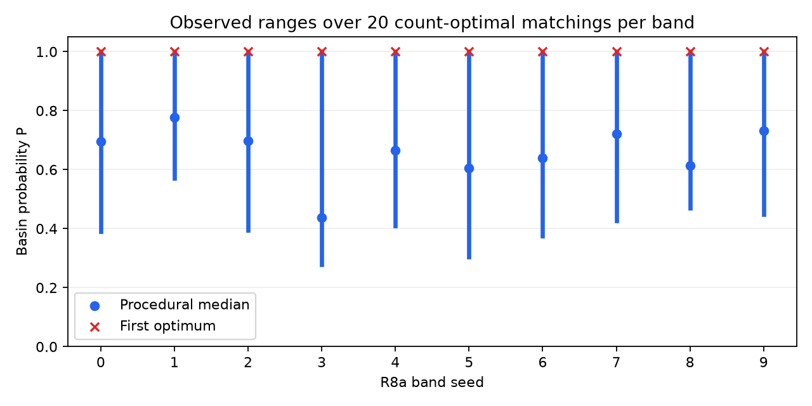

# Stage 1 evidence for specification v1.7

**Verification gate: PASS.** Stage 2 has not started; no Git release/tag exists.
[stage1-gate.json](stage1-gate.json) records the implementation digest,
command outcomes, logs and independent artifact checks.

Run from PowerShell:

```powershell
powershell.exe -NoProfile -ExecutionPolicy Bypass -File scripts/stage1-gate.ps1
```

The final suite passed **140 tests**, including TTK and TimesFM, with no
required integration skips. All 120 randomized bands returned equal OPTIMAL
counts from CP-SAT A, HiGHS A and CP-SAT B: 50 bands each at m=3 and m=4,
and 20 at m=8. The gate rechecked every saved integer witness, original cell
bounds, matching count and implementation digest. No agreement requirement
was waived. B used at most 88 separation rounds of its 200-round cap.

| Checks | Verified scope |
|---|---|
| T1, T21 | Reproducible arrays, canonical config identity, completion/resume |
| T2, T2b | Twelve ideal m=16 fields against independent calculations |
| T3 | Original 200-seed formula/regression check; fresh 2,000-seed paired calibration |
| T4, T5, T15, T22 | Torus incidence, known counts, basins, repeated/zero fields |
| T6, T7 | Twenty TTK critical-count comparisons; mandatory minima |
| T8, T23 | Full three-method agreement; historical solver cases with/without hints |
| T9–T11 | Twenty R8a count/reference comparisons, Morse identities, direct transfer |
| T14 | Two hundred property cases: exact witness iff fixed-y A feasible |
| T16, T24 | Four essential torus classes, TTK/GUDHI agreement, persistence contract |
| T17 | CPU TimesFM wrapper, covariates, shapes and repeated-batch determinism |
| T19, T25, T27 | All twelve ideal/noisy fields, symmetry and off-grid controls |
| T20 | Actual batch-generated signed/cycle cuts preserve feasible matchings and A optima |
| T26 | Narrow-band count eight; free-maximum collapse rejected by cell band |
| T28 | Every feasible vertex range checked against independent LPs on 100 cases |
| v1.7 additions | Compression equivalence, incomplete-agreement rejection, TTK ordering |

## R8a measurements

[stage1-r8a-v1.7-oracle.csv](stage1-r8a-v1.7-oracle.csv) contains the corrected
20-band run at m=16/N=1000. All optima are 32; LB_mand, LB_pers and UB_pers
equal 32. Every actual solve uses the accepted 32-cell TTK simplification
start. Its exact witness and count justify UB_pers for these bands.

Oracle bands cover the computed shot-free field in 19/20 runs. Direct
transfer passes in 20/20, with sep_min=0; only covered bands get a
transfer claim. The computed shot-free gradient has count 42, with explicit
rounded diagnostic 34. These discrete numerical fields are distinguished
from continuum claims and from the count optimum.

Ten bands produced 200 distinct sampled count-optimal matchings in total.
Their observed basin spread ranges from 0.4296875 to 0.72265625. P_first
is procedure dependent; sampled medians are procedural and ranges are
observed rather than exhaustive. The gate recomputes their statistics and
verifies distinct vertex-edge matchings and feasible optimal-count witnesses.
RQ2 is rescoped in v1.7 before any Stage 2 optimizer experiment.



## Statistical calibration and gate disposition

The original Gaussian coverage result is retained as 186/200. The fresh
paired study gives 1898/2000 (94.9%, Wilson 95% interval 93.85–95.78%) for
Gaussian and 2000/2000 for Hoeffding. Only Hoeffding has the finite-sample
guarantee; its intervals are wider. See
[coverage-study-v1.7.json](coverage-study-v1.7.json).

All seven §2a verification items are satisfied: local checks; known-answer
and collapse controls; complete cross-method agreement; twenty-band R8a
reference measurements; ten-band multiplicity measurement; persistence
cross-check; and the full conditional certificate proof in CERTIFICATE.md.
Numerical benchmark results do not become certificates. Larger grids may
time out and keep separate bounds/incumbents without an optimum.

[CORRECTIONS.md](CORRECTIONS.md) explains the findings and fixes. Original
failed v1.6 evidence remains under the original result paths and in
[archive/v1.6](archive/v1.6/README.md).
